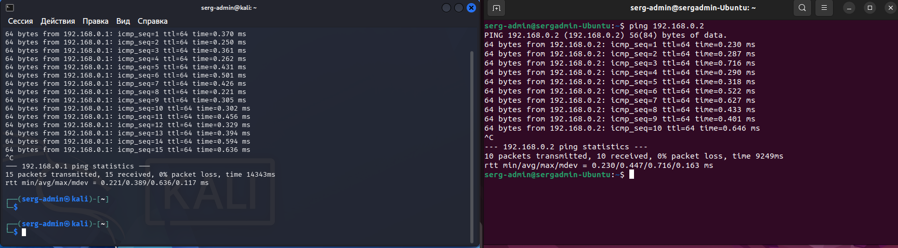
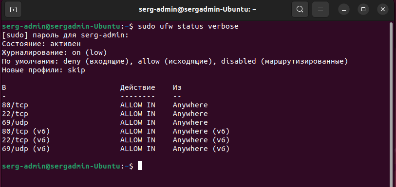
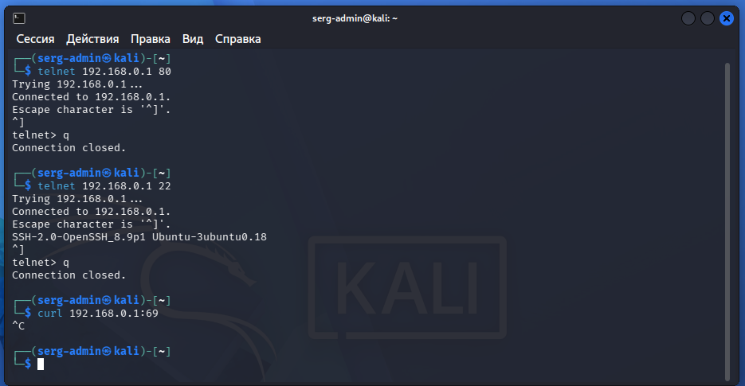
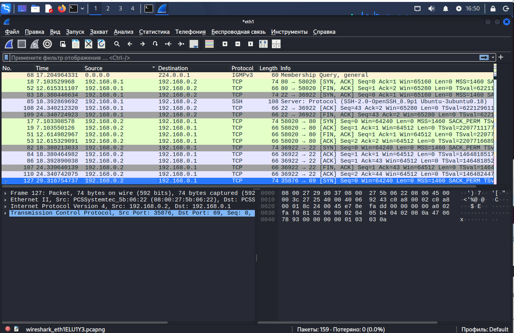

# Домашнее задание по теме «Протоколы транспортного уровня: TCP, UDP»

# Задание

Преподаватель: Игорь Александров, Антон Лукашов, Дмитрий Перьков
## Выполнив это задание, вы получите:

- Способность настроить сеть из двух виртуальных машин (Ubuntu и Kali) и проверить связь между ними с помощью команды ping
- Способность установить и запустить сетевые сервисы (HTTP, SSH, FTP) на Ubuntu и протестировать их доступность через утилиту telnet
- Способность настроить фаервол (ufw) для фильтрации трафика на уровне портов (TCP/UDP), разрешая только нужные соединения
- Умение анализировать сетевой трафик с помощью Wireshark и описать различия в установлении соединений при отключенном и включённом фаерволе
- Умение формулировать выводы о том, как фаервол взаимодействует с транспортным уровнем и влияет на TCP-соединения

# Инструменты, которые пригодятся для выполнения задания:

Виртуальная машина Ubuntu и Kali
 

Описание задания

## Задание 1.
В этом задании вам необходимо:

Развернуть две виртуальные машины (Ubuntu и Kali) и настроить между ними сеть.
Установить и настроить на Ubuntu веб-сервер (nginx), SSH-сервер и FTP-сервер.
С помощью Wireshark перехватить и проанализировать TCP/UDP сессии.
Настроить межсетевой экран, разрешив доступ только к портам 80 и 22.
Продемонстрировать работу экрана, предоставив:
Вывод команды sudo ufw status verbose
Скриншоты перехваченных сетевых сессий
Скриншоты блокировки трафика
Результаты оформите в виде отчёта со скриншотами и пришлите ссылку на облачное хранилище.

## Ожидаемый результат:

- настроены виртуальные машины для тестирования межсетевого взаимодействия;
- перехвачены TCP, UDP сессии;
- настроен межсетевой экран и получен результат блокировки портов.

## Инструкция к заданию описана в теме “Инструкции для выполнения домашнего задания по занятию «Протоколы транспортного уровня: TCP, UDP»”

 ## Ответ 1.

 1. Настроил две машины, прописал IP Ubuntu - 192.168.0.1 , Kali - 192.168.0.2
 Проверил доступность машин с помощью команды ping 

 

 2. Проверка Межсетового экрана

 

 2. Проверка портов 80, 22, 69 с помощью команд telnet и curl

 

 3. Анализ работы программы Wireshark

 

# Что необходимо прислать в качестве результата задания:

- Вывод команды sudo ufw status verbose
- Скриншоты успешного перехваченного соединения TCP, UDP
- Скриншот с отсутствием доступа из-за работающего межсетевого экрана.

На этой странице вы можете прочитать примеры расширенного синтаксиса настройки правил, позволяющих вам разрешать доступ с определённых ip, подсетей и т.д.

№ Как отправить ответ на задание:

- Скопируйте скриншоты в папку на Яндекс или Google Диск.
- Вставьте ссылку на вашу работу в поле «Ответ» и нажмите «Отправить».
- Проверьте, что вы предоставили доступ на редактирование всем, у кого есть ссылка.
- Критерии оценивания:

# Зачёт: присланы все результаты тестирования.
- Незачёт: не выполнено не одного пункта задания.
- На доработку: пункты задания выполнены частично.
- Незачёт: после доработки не учтены все существенные замечания проверяющего и/или в работе не соблюдены требования на оценку «зачёт»