# Домашнее задание по занятию «Работа с Cisco Packet Tracer» - Пономарёв Сергей Валентинович.

# Задание
Преподаватель: Игорь Александров, Антон Лукашов, Дмитрий Перьков
В этом задании вам предстоит научится настраивать локальную сеть состоящую из нескольких подсетей, маршрутизаторов и оконечных устройств. Также вы познакомитесь с отображением таблицы коммутации на коммутаторе.

## Цели задания:

- научится настраивать IP-адреса на сетевых устройствах
- научится проводить проверку сетевого соединения
- научится работать с интерфейсом Cisco Packet Tracer и сохранять проекты
- научится просматривать и анализировать таблицу коммутации
- получить навык подготовки и передачи файлов проектов (.pkt) как результата выполненной работы

## Чек-лист подготовки к выполнению домашнего задания:

Изучите лонгриды к занятию «Протоколы сетевого уровня: IPv4, IPv6»

## Инструменты, которые пригодятся для выполнения задания:

Cisco Packet Tracer.
 
## Описание задания:
Для выполнения этого задания вам будет необходимо установить Cisco Packet Trace. Инструкция по установке описана в теме “Инструкция по установке Cisco Packet Tracer”, занятие “Протоколы сетевого уровня: IPv4, IPv6”.

В этом задании вам необходимо настроить локальную сеть, состоящую из нескольких подсетей, маршрутизаторов и оконечных устройств, используя Cisco Packet Tracer.
Задание состоит из двух частей:

В первой части вам необходимо создать в Cisco Packet Tracer сетевую схему, включающую коммутатор, маршрутизатор, сервер и три компьютера. Настроить IP-адресацию на всех устройствах, активировать интерфейсы маршрутизатора и проверить связь между компьютерами и сервером с помощью команды ping.
Во второй части вам необходимо дополнить схему вторым маршрутизатором, создав две отдельные подсети. Настроить статическую маршрутизацию между маршрутизаторами для обеспечения связи между всеми устройствами сети. Проверить доступность сервера с компьютера с помощью команды ping и убедитесь в корректной работе сети.

## К каждой части дана пошаговая инструкция по выполнению задания 

(Инструкции находятся в отедельной теме - Инструкции для выполнения домашнего задания по занятию «Работа с Cisco Packet Tracer»).

## Задание 1.1.
К указанной схеме необходимо подключить ещё один компьютер (PC0 на изображении) к коммутатору, провести необходимые настройки оборудования, убедиться, что новый компьютер имеет доступ к серверу (с помощью команды ping ip-адрес-сервера).

 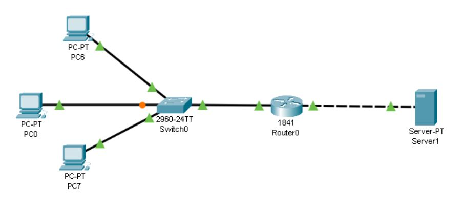
 
Для данной схемы сети вывести заполненную таблицу коммутации на коммутаторе Switch0 (команда для вывода таблицы коммутации: show mac-address-table).

Справка: нажимаете на ваш свитч, в открывшемся окне находите вкладку CLI и там вводите команду show mac-address-table

## Ответ 1.1.

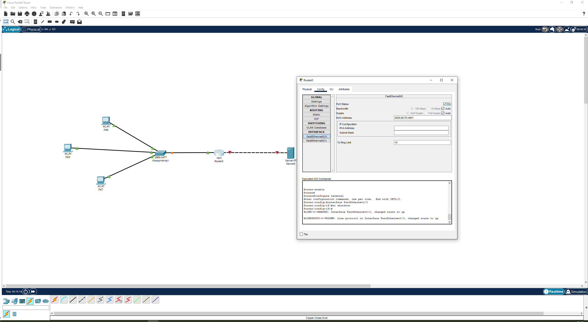
Создаём схему сети, состоящую из трёх ПК, подключённых к коммутатору. Коммутатор соединен с маршрутизатором, который, в свою очередь соединён с сервером.
Все соединения кроме «маршрутизатор-сервер» выполняются прямым кабелем, соединение «маршрутизатор-сервер» — перекрестным.

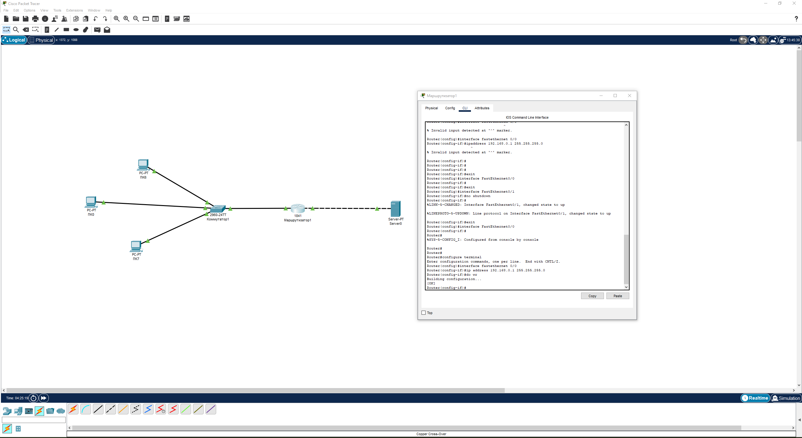
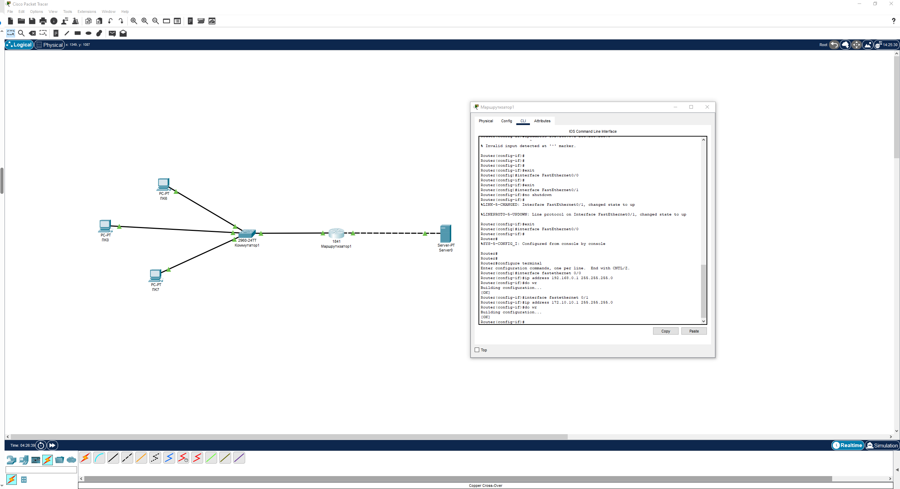
Производим сетевые настройки интерфейсов маршрутизатора , используя терминал CLI маршрутизатора

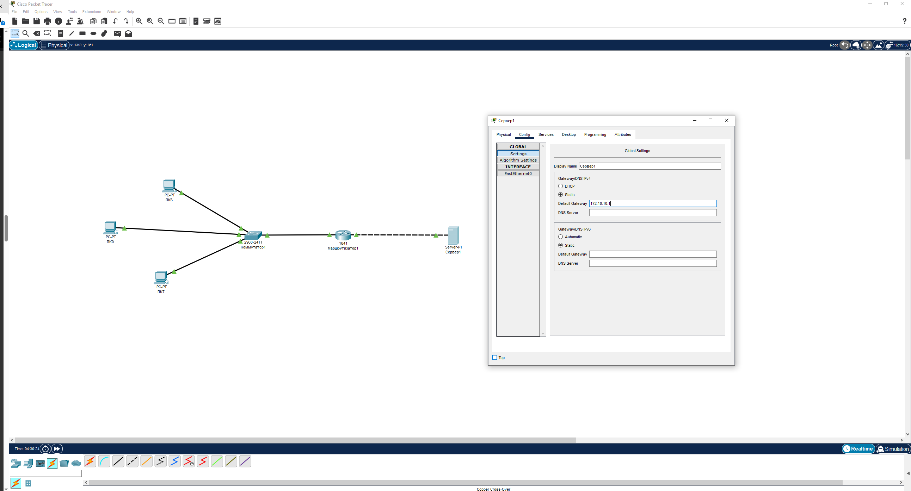
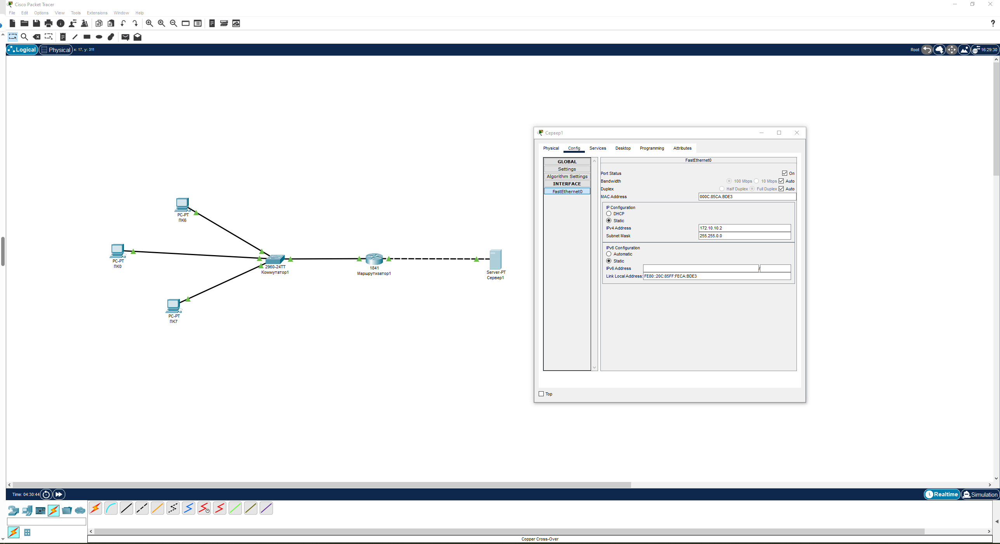
Проводим настройку сервера.

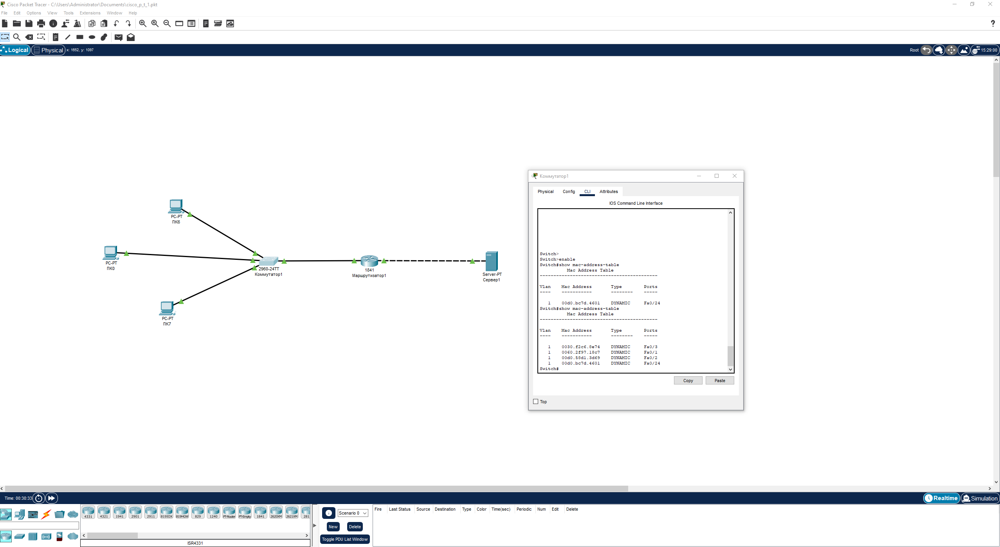
Отображение таблицы коммутации

````
Switch#show mac-address-table
          Mac Address Table
-------------------------------------------

Vlan    Mac Address       Type        Ports
----    -----------       --------    -----

   1    0030.f2c6.8e74    DYNAMIC     Fa0/3
   1    0060.2f97.18c7    DYNAMIC     Fa0/1
   1    00d0.58d1.3d69    DYNAMIC     Fa0/2
   1    00d0.bc7d.4601    DYNAMIC     Fa0/24
````

[Файл Cisco Packet Tracer](files/cisco_p_t_1.pkt)


## Задание 1.2.
Реализуйте схему, указанную ниже (для этого необходимо добавить Router1 и произвести на нём необходимые настройки по аналогии с лекцией). Убедитесь, что с PC0 проходит ping до сервера.

 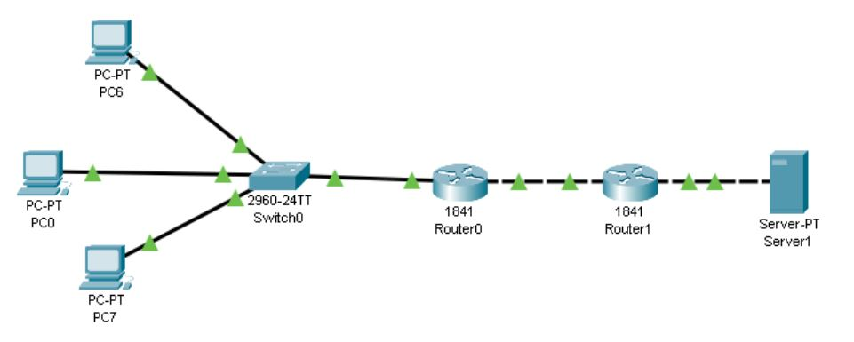
 
Ожидаемый результат: pkt-файл.

Что необходимо прислать в качестве ответа на задание:
Выполните задание, сделайте необходимые скриншоты, загрузите их на Яндекс диск и вставьте ссылку на вашу работу в поле «Ответ»:

пришлите pkt-файл
скриншот таблицы коммутации
Перед сдачей домашнего задания убедитесь, что вы предоставили доступ на просмотр всем, у кого есть ссылка.

 ## Ответ 1.2.

1. Вводим в имеющуюся схему сети маршрутизатор 2


2. Производим настройку сетевых интерфейсов маршрутизатора 2

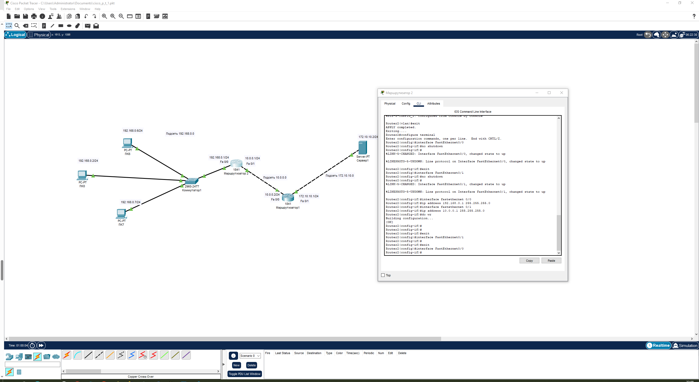

3. Производим перенастройку интерфейса 0/0 маршрутизатора 1

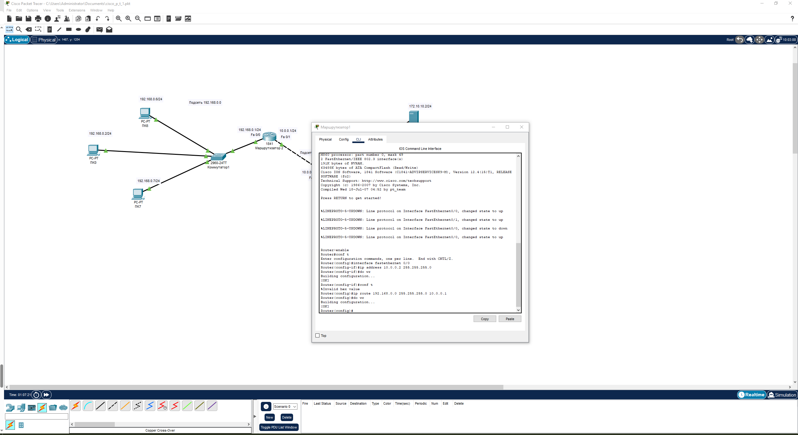

4. Производим настройку статического маршрута на маршрутизаторах

5. Проверяем работоспособность сети командой ping

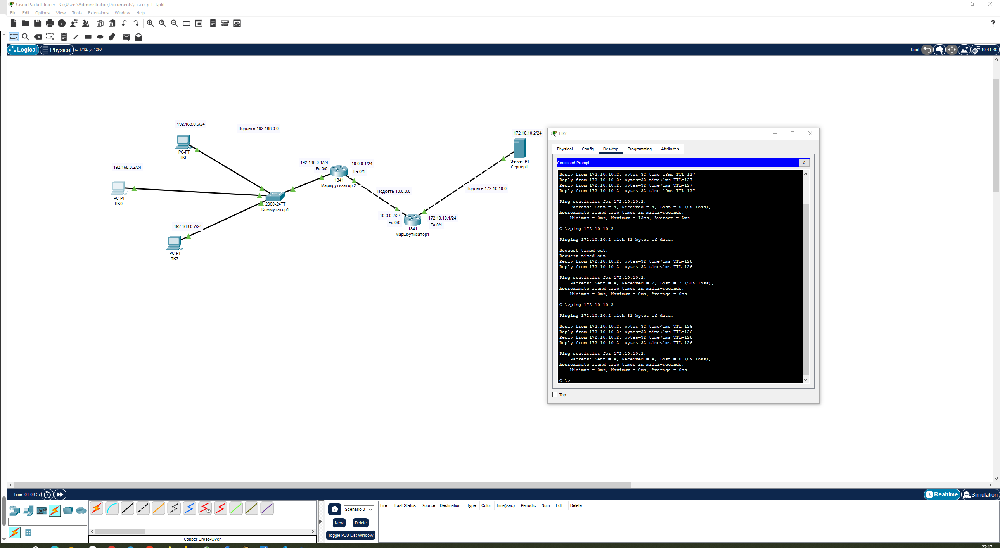
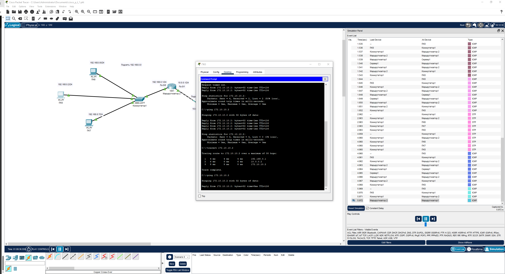


[Файл Cisco Packet Tracer](files/cisco_p_t_2.pkt)

# Критерии оценки:

## Зачёт:
- Сетевые настройки выполнены верно.
- Сеть от одного оконечного устройства до другого диагностируется по протоколу ICMP.
- На маршрутизаторах верно настроены статические маршруты.
- Ответ направлен в файле формата pkt. Таблица коммутации направлена в виде скриншота.

##На доработку:

Не выполняется один или сразу несколько критериев оценки.

## Незачёт:

После доработки не учтены все существенные замечания проверяющего и/или в работе не соблюдены требования на оценку «зачёт».